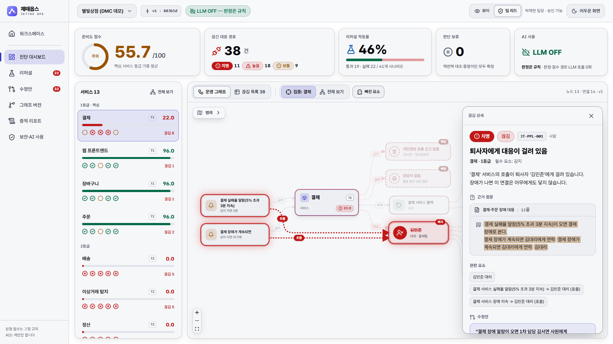
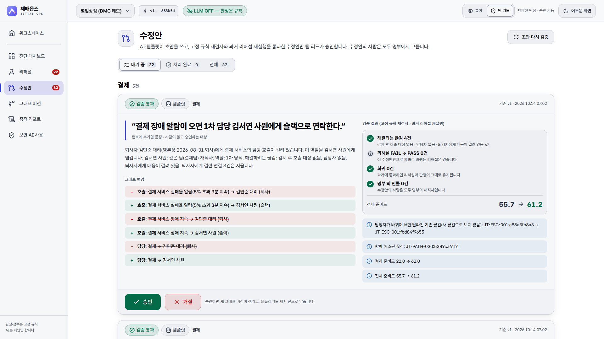
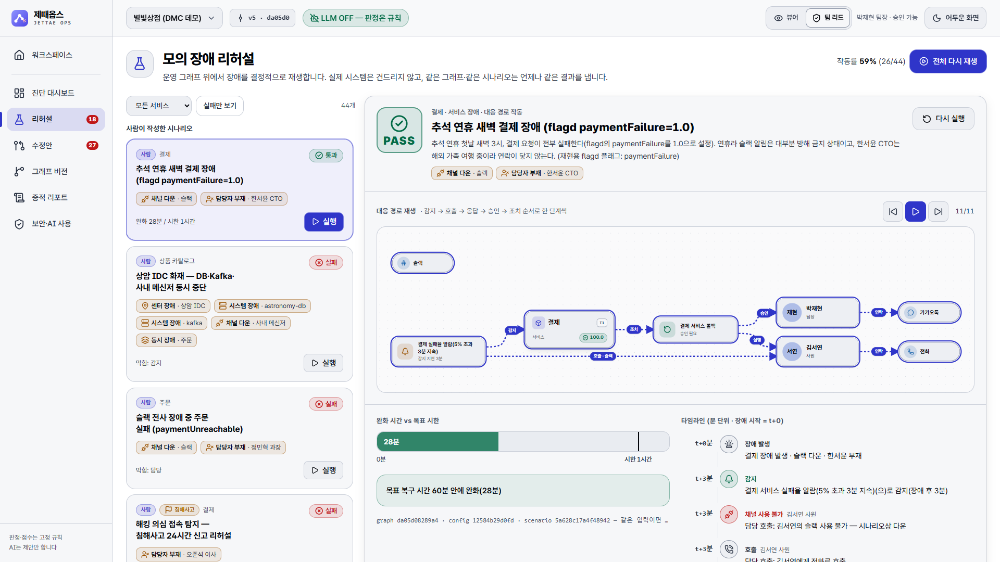
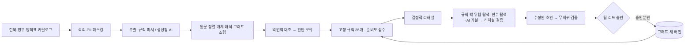

# 제때옵스 (JETTAE Ops)

**장애 대응 매뉴얼(런북)을 운영 그래프로 바꿔, 끊긴 대응 경로를 장애 전에 찾아내는 런북 준비도 진단 멀티에이전트**

> 기억 말고 그래프로, 끊긴 곳은 장애 전에.

**바로 체험하기:** https://jettae-ops.onrender.com — 별빛상점(가상 회사) 예제와 내 런북 무료 검진(공개 체험판: LLM 끔, 원문 비저장, 결과는 7일 뒤 자동 삭제)

런북을 넣으면 제때옵스는 네 단계를 거칩니다.
1. **변환:** "무엇이 어디에 연결되고, 누가 맡고 승인하며, 언제까지 알리나"를 원문 위치가 붙은 **운영 그래프**로 만듭니다.
2. **진단:** **고정 규칙**으로 끊긴 대응 경로와 준비도 점수(0~100)를 계산합니다.
3. **리허설:** 담당 부재·메신저 다운·센터 장애를 그래프 위에서 **결정적으로 리허설**합니다. 실제 시스템은 건드리지 않습니다.
   규칙이 묻지 않는 위험(두 사람이 함께 빠질 때, 연락 수단 두 개가 함께 멈출 때 등)은 자동 전수 탐색과 생성형 AI가 가설로 제안하고,
   같은 리허설이 확인·기각·확인 필요를 정합니다(**규칙 밖 위험 탐색**, 점수에는 반영하지 않음 — [docs/explore.md](docs/explore.md)).
4. **개선:** 고칠 문장을 제안하고, 그중 **팀 리드가 승인한 것만** 새 그래프 버전으로 반영합니다.



| 수정안: 명부의 사람만, 무회귀일 때만 승인 | 같은 리허설이 승인 후 통과 |
|---|---|
|  |  |

## 설계 원칙

| 원칙 | 보장하는 방법 |
|---|---|
| **AI는 제안, 판정은 규칙** | 끊김 판정·점수·리허설 판정·그래프 변경 모듈은 LLM을 import할 수 없습니다(`import-linter` 계약, CI에서 강제) |
| **지어내기 금지** | 모든 요소가 원문 문자 위치를 갖고, 정렬에 실패하면 폐기합니다. 없는 사실은 '없음'으로 남깁니다 |
| **확인 불가 ≠ 정상** | 판단 보류(역번역 대조 불일치, 명부 미확인 인물)는 점수에서 통과로 치지 않습니다 |
| **LLM을 꺼도 동작** | `JETTAE_LLM_MODE=off`에서는 규칙 파서 → 같은 파이프라인으로 돕니다 |
| **문서는 데이터** | 문서 속 지시문은 격리하고 출력은 스키마로 강제합니다. LLM은 명부 후보 중 선택만 하고, 그래프 변경은 코드가 만듭니다(CaMeL 원칙) |
| **결정성** | 같은 입력이면 같은 그래프 해시·점수·리허설 결과 해시가 나옵니다 |

설계 결정은 [docs/adr](docs/adr), 전체 구조는 [docs/ARCHITECTURE.md](docs/ARCHITECTURE.md), 근거 문헌은 [docs/references.md](docs/references.md)에 있습니다.

## 빠른 시작

Python 3.11 이상, Node 20 이상(웹 화면을 빌드할 때만)이 필요합니다.

```bash
python -m venv .venv
```

```bash
.venv/Scripts/python -m pip install -e ".[dev,anthropic]"
```

(macOS/Linux는 `.venv/bin/python`.) 웹 화면까지 쓰려면 한 번 빌드합니다:

```bash
cd web && npm ci && npm run build
```

### 1) 데모: 상암 DMC 가상 스타트업 '별빛상점'

```bash
jettae demo --open
```

<http://127.0.0.1:8765>에서 진단 대시보드 → 리허설 → 수정안 승인(우상단 역할을 **팀 리드**로) → 그래프 버전 → 증적 리포트 순서로 볼 수 있습니다.
데모 회사와 인물은 모두 가상이고 시스템 구성은 [OpenTelemetry Demo 3.1.0](https://github.com/open-telemetry/opentelemetry-demo)(Apache-2.0)을 따릅니다.
LLM을 끈 상태의 기준값(전체 55.7점, 결제 22.0점, 끊김 38건)은 [docs/demo-baseline.md](docs/demo-baseline.md)에 있습니다.

### 2) 내 런북 진단 (CLI)

```bash
jettae scan examples/dmc-shop
```

```bash
jettae scan ./my-runbooks --format sarif --out jettae.sarif --fail-under 60
```

- 출력 형식: `text` · `json` · `md`(ISMS-P 증적 리포트 초안) · `html` · `sarif`(GitHub 코드 스캐닝)
- 판정 규칙 전체 보기: `jettae rules` (규칙 ID·근거·법적 근거 공개 — [docs/rules.md](docs/rules.md))
- 점수 산식: [docs/scoring.md](docs/scoring.md)
- 규칙 밖 위험 탐색(가설 → 리허설 검증, 점수 미반영): 증적 리포트 9장·`--format json`의 `risk_hypotheses` — [docs/explore.md](docs/explore.md)

### 3) 생성형 AI 켜기

```bash
export ANTHROPIC_API_KEY=...        # Windows PowerShell: $env:ANTHROPIC_API_KEY="..."
```

```bash
jettae scan ./my-runbooks --llm live
```

- 기본 모델은 `claude-opus-5-5`입니다(구조화 출력, 서버 측 거절 폴백 사용). `JETTAE_ANTHROPIC_MODEL`, `JETTAE_ANTHROPIC_EFFORT`로 바꿀 수 있습니다.
- 설치형(원문 외부 전송 없음)은 vLLM 같은 OpenAI 호환 서버를 씁니다: `JETTAE_LLM_PROVIDER=openai`, `JETTAE_OPENAI_BASE_URL=http://127.0.0.1:8000/v1`, `JETTAE_OPENAI_MODEL=...`
- LIVE 모드는 규칙 파서와 AI 추출을 함께 씁니다(하이브리드). 판정·점수·리허설에는 어떤 모드에서도 LLM을 쓰지 않으며, 리포트에 `판정 경로 LLM 호출 0회`와 호출 수·토큰이 남습니다.
- 본선 현장처럼 네트워크가 불안정한 곳에서는 녹화 재생(`--llm replay`)을 씁니다: [src/jettae/orchestrator/demo.py](src/jettae/orchestrator/demo.py) 참고.

### 4) GitHub Action — 무료 런북 건강검진

```yaml
- uses: jettae-ops/jettae-ops@v0   # 공개 후 실제 저장소 경로로 바꾸세요
  with:
    path: runbooks
    fail-under: "60"
```

판정은 러너 안에서 고정 규칙으로 하고, 결과는 코드 스캐닝(SARIF)과 작업 요약으로 남습니다. 런북 원문은 러너 밖으로 나가지 않습니다(`llm: live`일 때만 사용자 본인의 키로 LLM 제공자에게 전송). 자세한 내용은 [action.yml](action.yml)에 있습니다.

### 5) 공개 베타 웹사이트로 배포 (Render)

랜딩 페이지·수요 측정·로그인 없는 무료 런북 검진을 공개 사이트로 띄웁니다. 저장소의 [render.yaml](render.yaml)을 Render Blueprint로 불러오고 관리자 토큰만 입력하면 됩니다(`JETTAE_AUTH_MODE=public`, LLM 끔).
익명 방문자는 예제와 자기 무료 검진 결과(접근 키로 열기)만 볼 수 있고, 수요 지표·사전 신청 명단(CSV)은 관리자 토큰으로 내려받습니다.
업로드 2 MB·런북 50,000자·동시 진단 1개·무료 검진 하루 50회·이벤트 하루 20,000건과 접속 주소별 횟수 한도, 무료 검진 7일·사전 신청 1년 자동 삭제, DB 외부 접속 차단이 `render.yaml`에 들어 있고, 이미지의 파이썬 패키지는 [constraints.txt](constraints.txt)로 고정합니다.
접속 주소별 한도가 읽는 방문자 주소(`JETTAE_CLIENT_IP_SOURCE`, render.yaml 값 `header:CF-Connecting-IP`, 코드 기본값 `peer`)는 배포 직후 관리자 토큰으로 `GET /api/v1/admin/request-info`를 불러 확인합니다.
단계별 안내(Windows PowerShell 명령, 배포 직후 확인, 삭제 요청 처리, 무료 DB 30일 만료 대비 포함): [docs/deploy.md](docs/deploy.md)

## 입력 형식

| 파일 | 내용 |
|---|---|
| `runbooks/` | `.md` `.txt` `.pdf` `.docx` `.html` 런북. 업로드 즉시 정규화 → 길이 보존 PII 마스킹 → 지시문 격리 |
| `roster.csv` | `이름,상태,직급,팀,역할,별칭,연락수단,퇴사일` (상태: 재직/퇴사/휴직, 연락수단: `슬랙;전화;카톡;사내메신저;이메일`) |
| `oncall.csv` | `이름,시작,종료,레벨` (`YYYY-MM-DD HH:MM`, 시간대가 없으면 Asia/Seoul) |
| `catalog.yaml` | 서비스·시스템·채널·위치·의존 관계. Backstage `catalog-info.yaml`, `docker-compose.yml`, Jaeger dependencies JSON도 자동 인식 |
| `policy.yaml` | 핵심 등급, 목표 복구 시간, 팀 합의 당직 기준, 최종 책임 역할, 규제 대상 서비스 |

예시는 [examples/dmc-shop](examples/dmc-shop)에 있습니다.

## 구조



레이어(위가 아래만 import): `api | cli | evalkit → orchestrator → improve | reporting | explore → rehearse → extract | check | store → ingest | llm → domain`

| 패키지 | 역할 |
|---|---|
| `jettae.domain` | 불변 운영 그래프·원문 위치·끊김·리허설·패치·버전 계약 (Pydantic v2) |
| `jettae.ingest` | 로더, 길이 보존 PII 마스킹, 프롬프트 인젝션 격리, 명부·당직표·카탈로그·정책 파서 |
| `jettae.extract` | 한국어 규칙 파서, LLM 추출기(청크·동시성), 원문 정렬, 개체 해석, 역번역 대조 |
| `jettae.check` | 고정 규칙(필수 경로·사람·상향·채널·시한·국내 신고·당직·카탈로그·단일 장애점), 점수, 영향 범위 |
| `jettae.rehearse` | 결정적 이산사건 리플레이, 템플릿·사람·AI 시나리오 |
| `jettae.explore` | 규칙 밖 위험 탐색: 결정적 전수 탐색(최소 조합)·AI 가설 제안 → 리허설 검증(확인됨·기각·확인 필요), 점수 미반영 |
| `jettae.improve` | 패치 적용·역연산·diff, 템플릿/AI 초안, 무회귀 검증, 승인·되돌리기 버전 관리 |
| `jettae.orchestrator` | LangGraph 파이프라인, 애플리케이션 서비스(API·CLI의 유일한 진입점) |
| `jettae.api` / `jettae.cli` | FastAPI REST + 웹 정적 서빙 / Typer CLI |
| `jettae.store` | 메모리·SQLAlchemy 저장소(SQLite/PostgreSQL), Alembic 마이그레이션 |
| `jettae.evalkit` | 봉인 결함 주입 평가셋, 조건별 하네스, 인젝션 자기 시험, κ·α |
| `web/` | React 19 + React Flow + ELK 웹 화면 |

## 평가 재현

정답이 구성상 정해지는 결함 주입 평가셋입니다. 생성기로 만든 가상 조직 20개 × 결함 10종 × 템플릿 문체 3종 × 위치 2에 정상 대조군을 더해 1,320건이고, 케이스별 SHA-256과 머클 루트로 봉인했습니다(실제 런북이 아닙니다, [docs/eval/kpi/README.md](docs/eval/kpi/README.md) 남은 차이).
결과와 해설은 [docs/eval/report.md](docs/eval/report.md)에 있습니다.

```bash
jettae eval run --conditions A,B,O
```

```bash
jettae eval injection
```

생성형 AI 조건(C·D·DR)은 API 키가 필요합니다. 실행 전에 호출 수와 토큰 추정치를 먼저 보여 주고, `--yes`로 확인해야 실행됩니다.

## 실데이터 실증

동결한 제품(커밋 `ccf3b4d`)을 실제 문서 두 종류에 돌렸습니다. 설계·결과·한계·재현 방법은 [docs/eval/realdata-results.md](docs/eval/realdata-results.md)에 있습니다.

- **GitLab 공개 런북 test 20건:** 제품 지적 59건의 정밀도 68.6%(두 LLM 코더가 같은 판정을 낸 51건 기준, 95% CI 55.0–79.7%).
- **같은 20건의 한국어 번역판(언어만 바꾼 대조, 번역은 추출 모델과 같은 Claude 계열):** 두 코더 일치 정밀도 71.8%(28/39)로 원문 68.6%와 같은 수준입니다. 다만 문서별로 나온 지적은 원문과 33건만 같아, 실행 간 안정성은 한계로 밝힙니다.
- **공개 사후 보고서 27건(한국 5 · 해외 22):** 보고서가 말한 대응 공백 378개 중 제품 규칙 범위에 드는 것은 41개(약 11%, 두 코더가 모두 동의한 값 — 코더별 13–40%)뿐입니다. 제품 범위의 한계입니다.
- 2026-10-22 개발자 1인 블라인드 검토(코더 판정을 가림) 결과를 코더 수치와 나란히 공개합니다.
- **신청서 KPI·추가 측정(대부분 합성 봉인셋 기준):** [신청서 KPI 결과](docs/eval/kpi/README.md) — AI 수정 초안 재검사 통과율은 LLM 86.8%·템플릿 89.7%로 목표 90%에 못 미쳤고, 다른 계열 모델이 고쳐 쓴 문장에서는 규칙 파서의 정상 문서 오탐이 0%에서 91.3%로 올랐습니다. [AI 기여 분리(2×2)](docs/eval/llm-2x2-sample20/README.md) — 봉인셋 20% 표본에서 규칙 파서가 구어체 활성 결함도 62/63을 잡아(규칙 파서를 같은 생성기로 다듬음) "구어체에서는 AI가 필요하다"는 신청서 가설은 지지되지 않았고, LLM만으로 추출하면 정상 문서 28건 모두에서 오탐이 나서 LLM을 켤 때는 규칙과 합친 하이브리드를 씁니다.

## 개발

```bash
python -m pytest
```

```bash
python -m ruff check src tests && python -m mypy src && lint-imports
```

```bash
cd web && npm test && npm run build
```

CI(`.github/workflows/ci.yml`)는 위 검사와 평가 스모크, 웹 빌드를 모두 돌립니다.

## 보안·개인정보

- 기본은 원문 비저장입니다(`JETTAE_STORE_RAW_DOCUMENTS=false`). 연락처·이메일·IP·주민번호·카드번호는 길이를 보존한 채 마스킹합니다. 명부의 이름·재직 상태·역할·연락 수단 종류는 진단에 쓰므로 가리지 않습니다(공개 사이트 무료 검진은 카탈로그 설명과 명부 직급·팀 같은 자유 글자도 가립니다).
- 수정안 승인·거절·되돌리기는 `lead`/`admin`만 할 수 있고, 모든 변경은 감사 로그에 남습니다.
- 공개 모드(`JETTAE_AUTH_MODE=public`)에서 익명 방문자는 예제와 접근 키를 가진 워크스페이스만 엽니다(키는 해시로만 저장). 사전 신청 명단은 `admin`만 받고 지웁니다.
- 공개 사이트(`JETTAE_AUTH_MODE=public`)는 무료 검진 결과를 7일, 사전 신청을 1년 보관한 뒤 스스로 지웁니다(다른 모드에서는 자동으로 지우지 않습니다). 방문자 IP는 횟수 제한에만 쓰고 로그·DB에 남기지 않으며(uvicorn 접속 로그 끔), 앱 로그는 경로 속 이메일을 가립니다. 개인정보 처리방침(국외 이전 포함)은 `/privacy`에 있습니다.

자세한 내용은 [docs/security.md](docs/security.md)를 보세요.

## 라이선스

Apache-2.0. 예제는 OpenTelemetry Demo(Apache-2.0)의 서비스 구성을 사용합니다.
